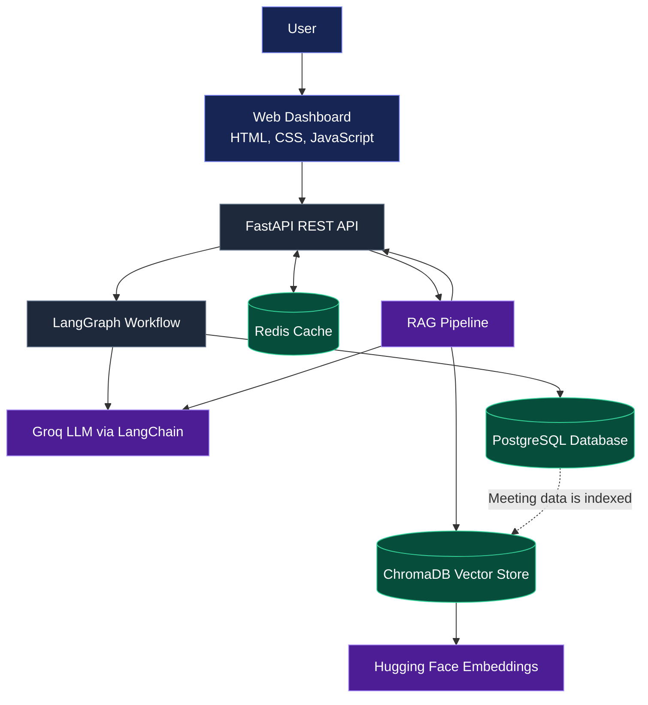

# AI Meeting Intelligence & Task Automation Platform

An AI-powered application that transforms meeting transcripts into structured summaries, decisions, action items, responsibilities, deadlines, and follow-up questions. It also provides Retrieval-Augmented Generation (RAG) to answer questions using information from stored meetings.

## Overview

Meeting discussions often contain important decisions and tasks that are difficult to track manually. This project uses Large Language Models (LLMs), agentic workflows, and a retrieval-based question-answering system to make meeting information easier to organize and access.

The platform provides a web dashboard for submitting meeting transcripts, reviewing action items, exploring meeting history, and asking questions about previous discussions.

## Features

- **AI Meeting Analysis:** Generates meeting summaries, discussions, and decisions from transcripts.
- **Action Item Extraction:** Identifies tasks, responsible participants, and deadlines when available.
- **Validation and Follow-ups:** Checks extracted action items and identifies missing information that may require clarification.
- **LangGraph Workflow:** Organizes meeting analysis, action-item extraction, validation, and follow-up processing into workflow nodes.
- **REST API:** Provides endpoints for creating and retrieving meetings, accessing action items, and asking questions.
- **PostgreSQL Database:** Persists meeting transcripts, analysis results, and action items.
- **Redis Caching:** Caches frequently requested meeting and action-item data, along with RAG responses.
- **RAG-based Question Answering:** Uses ChromaDB vector search to retrieve relevant meeting information before generating answers.
- **Meeting-specific and Global Search:** Ask questions about one meeting or across stored meetings.
- **Web Dashboard:** HTML, CSS, and JavaScript interface for managing meetings, viewing action items, and interacting with the AI assistant.

## Technology Stack

| Component | Technology |
|---|---|
| Programming Language | Python |
| Backend Framework | FastAPI |
| API Documentation | Swagger UI / OpenAPI |
| LLM Integration | Groq via LangChain |
| Agentic Workflow | LangGraph |
| Database | PostgreSQL |
| ORM | SQLAlchemy |
| Caching | Redis |
| Vector Database | ChromaDB |
| Embeddings | Hugging Face sentence-transformer model |
| Frontend | HTML, CSS, JavaScript |
| API Testing | Swagger UI |
| Version Control | Git and GitHub |

## Architecture


## Architecture

The platform connects a web dashboard to a FastAPI backend, which coordinates meeting analysis, data storage, caching, and retrieval-based question answering.




## Project Structure

```text
AI_Meeting_Intelligence/
├── frontend/
│   ├── index.html
│   ├── style.css
│   └── script.js
├── api.py
├── main.py
├── graph.py
├── database.py
├── models.py
├── crud.py
├── redis_client.py
├── redis_service.py
├── vector_store.py
├── rag_service.py
├── rag_qa.py
├── requirements.txt
├── .gitignore
└── README.md
```

### Main Files

- `api.py` — FastAPI application and REST endpoints.
- `main.py` — Core meeting-analysis logic and LLM integration.
- `graph.py` — LangGraph workflow for meeting processing.
- `database.py` — PostgreSQL database configuration and connection.
- `models.py` — Database models.
- `crud.py` — Database create, read, and related operations.
- `redis_client.py` — Redis connection setup.
- `redis_service.py` — Redis caching operations.
- `vector_store.py` — ChromaDB vector-store configuration.
- `rag_service.py` — Meeting indexing, retrieval, and RAG-related services.
- `rag_qa.py` — Question-answering logic for meeting information.
- `frontend/` — Web dashboard files.

## Getting Started

Follow these instructions to run the project locally on Windows.

### Prerequisites

Install or configure the following:

- Python and Conda
- PostgreSQL
- Redis
- Git
- A Groq API key
- The project source code

### 1. Clone the Repository

```bash
git clone https://github.com/UserSarthak/AI_Meeting_Intelligence.git
cd AI_Meeting_Intelligence
```

### 2. Activate the Python Environment

If you already use the project's Conda environment:

```bash
conda activate meeting_ai
```

If you are setting it up on a new machine, create and activate an environment first:

```bash
conda create -n meeting_ai python=3.11 -y
conda activate meeting_ai
```

### 3. Install Dependencies

```bash
python -m pip install -r requirements.txt
```

### 4. Configure Environment Variables

Create a local `.env` file in the project root.

Configure the Groq API key, PostgreSQL connection settings, and any other environment variables required by the application. Use the exact variable names expected by the project's Python files.

**Security:** Never commit `.env` or expose API keys, database passwords, or other credentials. Keep secrets in environment variables and ensure `.env` is excluded by `.gitignore`.

### 5. Start PostgreSQL and Redis

Make sure PostgreSQL is running and the configured database is available.

Start your Redis server and verify the connection if needed. The application uses these services for persistent storage and caching.

### 6. Start the FastAPI Backend

From the project root, run:

```bash
uvicorn api:app --reload
```

The API should be available at:

- **API base URL:** http://127.0.0.1:8000
- **Swagger documentation:** http://127.0.0.1:8000/docs
- **OpenAPI schema:** http://127.0.0.1:8000/openapi.json

### 7. Start the Web Dashboard

Open a **second terminal** and navigate to the project root:

```bash
cd /d D:\Projects\AI_Meeting_Intelligence
python -m http.server 5500 --directory frontend
```

Then open:

http://localhost:5500

Keep both the backend and frontend servers running while using the dashboard.

## API Endpoints

| Method | Endpoint | Description |
|---|---|---|
| `GET` | `/` | Check the API welcome response |
| `GET` | `/health` | Check API health |
| `POST` | `/meetings` | Process and store a meeting transcript |
| `GET` | `/meetings` | Retrieve stored meetings |
| `GET` | `/meetings/{meeting_id}` | Retrieve a meeting by ID |
| `GET` | `/action-items` | Retrieve action items |
| `GET` | `/meetings/{meeting_id}/action-items` | Retrieve action items for a meeting |
| `POST` | `/meetings/ask` | Ask questions across stored meetings |
| `POST` | `/meetings/{meeting_id}/ask` | Ask questions about a specific meeting |

For request schemas, response formats, and interactive testing, open the Swagger documentation at `http://127.0.0.1:8000/docs`.

## Example Usage

### Create a Meeting

Send a `POST` request to `/meetings` with a JSON body:

```json
{
  "transcript": "Rahul will complete the backend API by Friday. Priya will handle database integration. The team decided to use PostgreSQL."
}
```

The API processes the transcript, saves the results, and indexes the meeting for retrieval.

A successful response includes a meeting ID:

```json
{
  "message": "Meeting processed successfully",
  "meeting_id": 1
}
```

The actual meeting ID is generated by the database.

### Ask a Question Across Meetings

Send a `POST` request to `/meetings/ask`:

```json
{
  "question": "Which database did the team decide to use?"
}
```

The response contains the question and the generated answer based on the available meeting information.

### Ask a Question About One Meeting

Send a `POST` request to `/meetings/1/ask`:

```json
{
  "question": "Who is responsible for completing the backend API?"
}
```

Replace `1` with the actual meeting ID.

## How RAG Works

The Retrieval-Augmented Generation pipeline follows these steps:

1. A new meeting transcript is submitted.
2. The meeting is analyzed and saved in PostgreSQL.
3. The transcript is split into smaller text chunks and indexed in ChromaDB using embeddings.
4. A user submits a question through the API or dashboard.
5. The system retrieves relevant meeting information from the vector store.
6. The LLM uses the retrieved context to formulate an answer.
7. Redis caching can reduce repeated processing for previously asked questions.

The system also includes handling for missing information so it can avoid presenting unsupported answers as established facts.

## Testing

You can test the application using:

- **Swagger UI:** Submit requests and inspect responses at `/docs`.
- **Postman:** Test the REST API endpoints.
- **Web Dashboard:** Create meetings, inspect meeting history, filter action items, and ask questions.
- **Redis CLI:** Inspect cache keys and TTL values when verifying caching behavior.

## Current Scope and Future Improvements

Potential next improvements include:

- Automated test coverage for API endpoints and RAG behavior.
- Deployment of the backend and frontend to a hosting platform.
- Authentication and role-based access control.
- Task status tracking and editing.
- Integration with external project-management tools.
- More comprehensive monitoring, logging, and error handling.

These are future enhancements and should not be considered completed unless implemented.

## Security Notes

- Do not commit `.env` files or credentials.
- Do not expose database credentials in source code.
- Use appropriate CORS settings for production.
- Configure production secrets and database access securely before deployment.

## Author

**UserSarthak**
